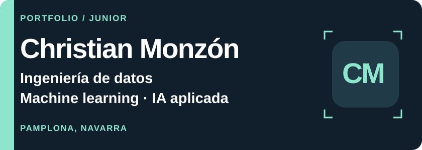
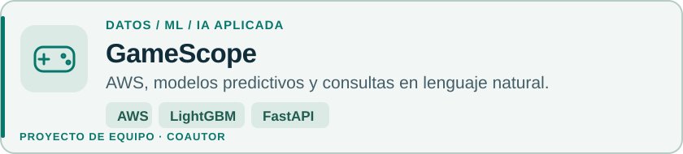
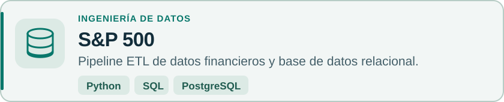
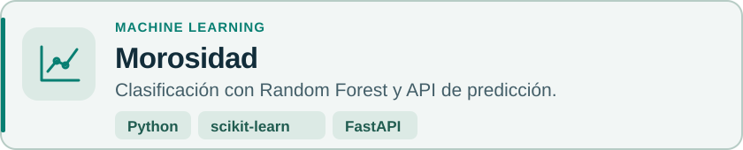
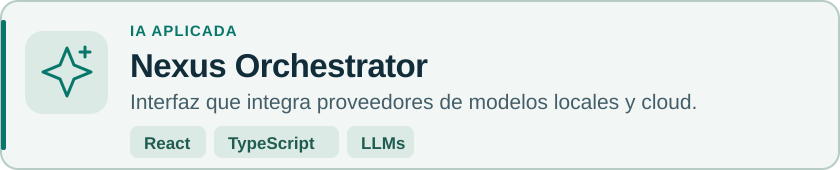
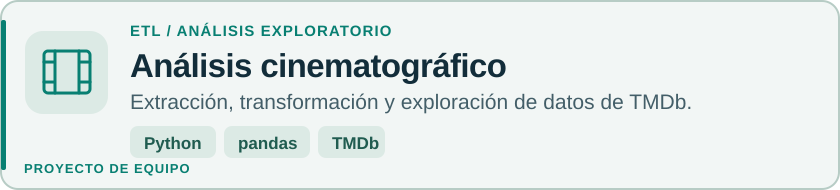

<picture>
    <source media="(max-width: 600px)" srcset="assets/header-mobile.svg">
    
  </picture>

Desarrollo proyectos con **Python y SQL**, modelos predictivos, APIs e integración de IA. Busco oportunidades **junior** en **ingeniería de datos y Big Data, machine learning e IA aplicada**.

[**Conectemos en LinkedIn**](https://www.linkedin.com/in/christian-monzon-514746371/) · Abierto a oportunidades

## Proyectos

Portfolio de proyectos formativos, personales y en equipo. Selecciona una tarjeta para ver su implementación.

<a href="https://github.com/mcayuela89/GameScope_Video_Game_Intelligence_Pipeline_ML_API">
  <picture>
    <source media="(max-width: 600px)" srcset="assets/gamescope-mobile.svg">
    
  </picture>
</a>

Equipo: Miguel Ángel Cayuela, Daniel Nedelcu, Doru Catalin Cristian y Christian Monzón Iribarren.

<a href="https://github.com/TeoFilaX/Data_Base_S-P500">
  <picture>
    <source media="(max-width: 600px)" srcset="assets/sp500-mobile.svg">
    
  </picture>
</a>

<a href="https://github.com/TeoFilaX/MODELO_PREDICCION_DE_MOROSOS">
  <picture>
    <source media="(max-width: 600px)" srcset="assets/morosidad-mobile.svg">
    
  </picture>
</a>

<a href="https://github.com/TeoFilaX/Nexus-Orchestrator-v2.1">
  <picture>
    <source media="(max-width: 600px)" srcset="assets/nexus-mobile.svg">
    
  </picture>
</a>

<a href="https://github.com/TeoFilaX/Analisis_cinematografico">
  <picture>
    <source media="(max-width: 600px)" srcset="assets/cine-mobile.svg">
    
  </picture>
</a>

Equipo: Christian Monzón, Miguel Cayuela y Daniel Nedelcu.

También: [**Análisis de vivienda · INE**](https://github.com/TeoFilaX/Analisis_vivienda_2025) — extracción, preparación y visualización del índice de precios de vivienda en un notebook.

## Tecnologías en mis proyectos

      

Trabajo con **pandas, NumPy, SQLAlchemy, Jupyter, Git y GitHub**. En GameScope, proyecto de equipo, se utilizan **AWS Lambda, S3, RDS y LightGBM**. Mi orientación a Big Data parte de esta base y de mi formación; quiero seguir ampliándola hacia sistemas de mayor escala.

---

**Formación · HACK A BOSS**  
Bootcamp en Inteligencia Artificial y Big Data · Septiembre de 2025 – febrero de 2026

[**LinkedIn**](https://www.linkedin.com/in/christian-monzon-514746371/) · [GitHub](https://github.com/TeoFilaX) · Pamplona, Navarra
